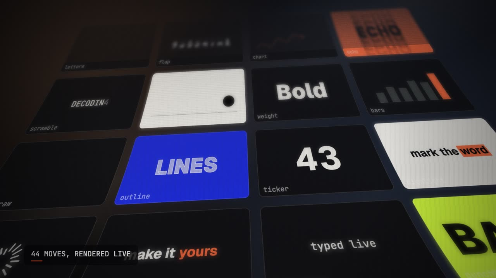

# motionkit

Make motion-graphics films in code, with a coding agent doing the work. Point it at a video whose motion you like and it rebuilds the timing and movement with **your own words and art**, or it builds a new film cut to a beat from 44 ready-made moves. The soundtrack is synthesised to match, so every film comes out with sound.

[](media/launch.mp4)

**[Watch the 30 second launch film](media/launch.mp4)**. It was made with motionkit, from a prompt, and cut to a real song.

It is an agent skill with its engine inside it: install the skill, and the agent checks your machine, installs what is missing (after asking you), and makes films in whatever folder you are working in.

## What you get

- **44 moves**: type reveals, transitions, camera moves, charts, finish passes. One line declares a move and gives its picture, its sound and a reading-time check.
- **A soundtrack engine**: drums, bass, pad and risers on a beat grid, a sound for every move, mixed to -16 LUFS. Everything is synthesised; there are no samples.
- **Stage pieces for product films**: glass panels, a moving camera, planes that lean away with depth of field, a wall of live clips, a terminal, code and a waveform, so a film can show the product and not only headlines.
- **Cut to a real song**: `beats.py` finds a track's beat, the film is written in beats, and the build mixes the music in and checks every cut against it.
- **Overlays for a video editor**: see-through animated titles (ProRes 4444 with alpha) with move sounds only, and steps for placing them on an [EditMax](https://github.com/SkidGod4444/editmax) timeline through its MCP tools without moving the cut.
- **Reference intake**: turns any clip into numbered frames, a cut list and a starter film.
- **Checks that need no eyes or ears**: sound lands on the beat, picture and bass land on the same frame, on-screen text stays up long enough to read.
- **The skill** (`skills/motionkit/SKILL.md`): the whole workflow, written for an agent.

## Install

**Claude Code, one step** (version 2.1.275 or later):

```
/plugin install motionkit --marketplace SkidGod4444/motionkit
```

**Any agent that reads skills, by hand.** Copy the skill folder (it holds the engine) into your skills folder:

```sh
git clone https://github.com/SkidGod4444/motionkit
cp -R motionkit/skills/motionkit ~/.claude/skills/motionkit
```

Then, in any project, ask your agent:

- "Set up motionkit and build the hello film."
- "Make a 10 second launch film for my app. Here are the brand colours and the logo."
- "Clone the motion of `clip.mp4` with this copy instead: ..."

On first use the agent runs the setup check. The engine needs [bun](https://bun.sh), [ffmpeg](https://ffmpeg.org), Python 3, [uv](https://docs.astral.sh/uv/) (it fetches numpy for the soundtrack) and Chrome, Chromium or Edge. The agent lists what is missing and asks before installing anything.

## Use it by hand

`E` is the engine folder, `skills/motionkit/engine` wherever the skill was installed. Run these from the folder where you want your films.

| command | what it does |
|---|---|
| `sh $E/setup.sh` | check what is installed; `--install` installs what is missing |
| `bun $E/build.ts hello` | build the 15.5 s example film into `out-hello/` |
| `bun $E/build.ts moves` | build the gallery of every move (88 s, takes a few minutes) |
| `bun $E/new.ts <name>` | start your own film: `<name>.html` and `<name>.js` here (`--overlay` for a see-through title) |
| `bun $E/build.ts <name>` | soundtrack, checks, render, final mp4 in `out-<name>/` |
| `bun $E/render.ts --page <name>.html --out out-<name> --frame 10,40` | stills of single frames |
| `bun $E/ref.ts <file or url> --name <name>` | intake of a reference clip into `ref/<name>/` |
| `python3 $E/compare.py sheet.jpg 10 40 --ref ref/<name> --out out-<name>` | reference and render side by side |
| `python3 $E/check.py <name>` | brightness of every frame against the reference |
| `uv run $E/beats.py <song> --from 7.5 --len 30 --out beats.json` | find a song's beat and write the beat table a film cuts on |
| `bun $E/pure.ts <name>` | confirm frames render the same alone and after other frames |

A film is one script whose `renderFrame(f)` draws frame `f`; `hello.js` is the model. For your own brand, call `MOVES.setBrand({ ... })` on the first line and put your art in `assets/`. Add `out-*/` and `ref/` to your `.gitignore`.

## Copy the motion, not the content

This is the rule the skill is built around. Timing, layout and movement are studied from a reference. The words, logos, characters, footage and music of someone else's video are not copied: write your own copy, draw your own art, and let the soundtrack be synthesised. Reference clips stay in the git-ignored `ref/` folder and never go into a film or a commit. You are responsible for having the right to use whatever you feed in and whatever you publish.

## Where the moves come from

The last column of the move table names the public technique or component demo each move was studied from, mostly the technique list at motionvideo.xyz and the component previews at snapcn.dev. This project is independent of both and is not endorsed by either. It contains none of their code, prompts or assets: every move is original canvas code written from watching a public preview or from a one-line description of a common technique. They are look-alikes, close in feel, not the same components. If you want the real components, get them from those sites.

## Known limits

- Tested on macOS only. Linux install commands and browser paths are included but untried; Windows needs WSL.
- Films are 1920x1080 at 30 frames a second (encoded at 60). There is no vertical format yet.
- The sound checks measure timing and loudness, not taste. One musical style, and only 150, 120, 100 and 90 bpm.
- The automatic clone check compares brightness only; shape and movement are judged by eye on side-by-side sheets.
- Films can place still images, not video.
- The EditMax placement steps are written from EditMax's tool definitions and have not yet been run against the app.

## Credits

The launch film's music is "EDM Detection Mode" by Kevin MacLeod (incompetech.com), licensed under Creative Commons: By Attribution 4.0. The terminal in the film is a plain drawing of a Claude Code session; motionkit is an independent project and is not made or endorsed by Anthropic.

## Licence

Code: MIT, see `LICENSE`. Fonts in `skills/motionkit/engine/fonts/` (Archivo, Geist, Geist Mono, JetBrains Mono): SIL Open Font License 1.1, texts alongside them.
